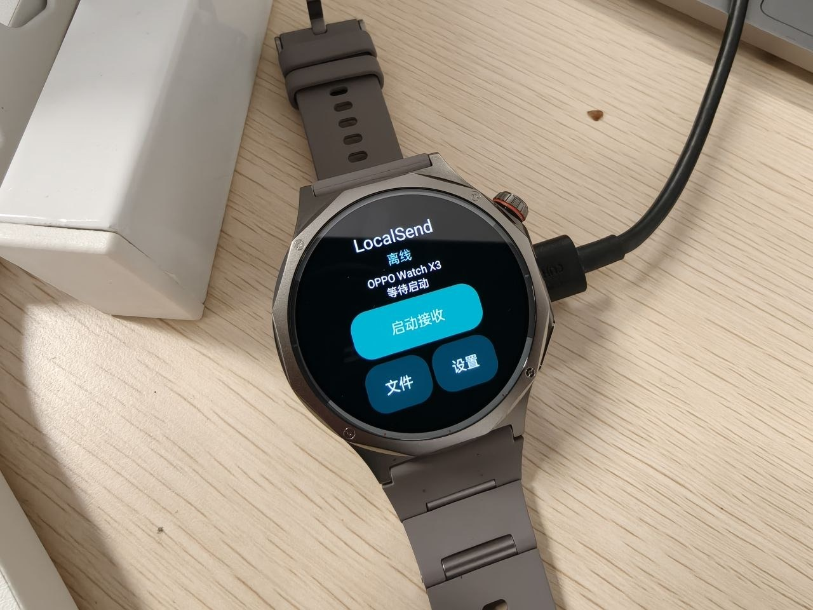

# LocalSend Watch


让圆屏 Android 手表也能接收手机发来的文件。手机继续使用原版 LocalSend，手表通过同一 Wi-Fi 接收文件，并可将收到的 APK 交给系统安装器安装。

**非官方 LocalSend 兼容接收端**，独立原生 Java 实现公开 LocalSend v2 协议，针对圆屏重新设计接收、文件管理和设置界面；不是官方发行版，也不是官方应用的 fork。

## 实机展示

<p align="center">
  
</p>

<p align="center">OPPO Watch X3 实机：圆屏主页、启动接收、文件与设置入口。</p>

## 功能

- LocalSend 青绿色风格，圆屏首页、独立文件列表、设置、接收确认、传输进度与完成页。
- 支持右滑返回上一层，与系统返回键共用导航；名称编辑页从左侧边缘右滑，避免影响光标操作。
- 修改并持久保存设备名称；首页、HTTPS 设备信息和 UDP 发现使用同一名称。
- 局域网发现、HTTPS 接收；每批人工接受或拒绝，支持取消。
- 打开、导出、删除收到的文件。APK 交给系统安装器，不静默安装。
- 每安装独立 TLS 身份，升级保留密钥与收到的文件。同名文件不覆盖。

当前为**接收端**，不包含手表主动发送；不接收整个文件夹。

## 使用

1. 从 Releases 下载签名 APK，通过设备支持的侧载方式首次安装。
2. 手机与手表连接同一可互通 Wi-Fi；手表启动接收，手机 LocalSend 选择显示的设备名称。
3. 在手表核对来源和文件后接收；收到 APK 后可选择安装。
4. 用完停止接收。不需要无线 ADB、root 或 Shizuku。

发现使用 UDP `224.0.0.167:53317`，传输使用 HTTPS TCP `53317`。访客网络/AP 隔离或 VPN 阻断局域网可能影响发现；可尝试手机手动输入手表 IP。切换网络后停止再启动接收。

## 数据与安全

- 默认每批确认，不自动接受；HTTPS 加密，但局域网中的设备名和 IP 不是发送方身份认证，敏感文件请核对发送方。
- 每批最多 64 个文件；不设固定文件/批次字节上限，以磁盘剩余空间为准，保留 16 MiB 空间。
- 来源 IP 与随机上传 token 绑定；路径检查、严格长度及可选 SHA-256 检查，临时文件同步后改名；不覆盖同名文件。
- 文件保存在应用专属 Downloads/LocalSend，**卸载应用会删除**。重要文件先导出；导出取决于系统是否提供文件选择器。
- TLS 私钥仅保存在设备私有目录，不包含在 APK 或仓库中。发布签名私钥不公开。
- 不读取其他应用私有数据，不需要广泛存储、定位或相机权限。

## 构建

JDK 17、Android SDK platform 35 / build-tools 35.0.0、Python 3 和 zip。设置 `ANDROID_HOME` 指向 SDK。

```sh
python3 scripts/integration_test.py
UNSIGNED=1 sh scripts/build_apk.sh
# 签名构建：KEYSTORE 指向自己的 keystore，PASSWORD 通过环境安全提供
sh scripts/build_apk.sh
```

未提供签名私钥；自行签名的 APK 不能覆盖安装发布版，除非证书相同。macOS 本地维护者可通过 Keychain 服务提供密码；不要把密码写入源码或上传。

测试自动下载校验 SHA-256 的宿主专用 `org.json:json:20240303`，不打入 APK。完整运行包含超过 512 MiB 真实 HTTPS 文件传输，需要足够磁盘空间。

## 验证范围

- 宿主执行生产接收引擎：核心逻辑、圆屏几何/名称/状态，以及 HTTPS 接收/拒绝/token/大小/路径/hash/取消/断传等检查。
- OPPO Watch X3（Android 11 / API 30，466×466）实测 HTTPS 接收、圆屏页面、改名和持久保存。测试发送端为协议模拟器。
- 使用者已确认原版手机 LocalSend → 手表发送 APK 并通过系统安装器安装成功（1.0.0）；后续改版仍需在其他设备与更多场景验证。
- 右滑返回包含 22 项宿主手势逻辑断言；使用者已确认 1.1.2 右滑返回使用正常。
- OEM 熄屏长时间接收、其他型号兼容性及文件导出未完整验证。大文件回归在宿主进行，不代表手表大文件性能。

## 来源与许可证

原创项目代码以 MIT 许可发布。协议参考：LocalSend protocol；主题与页面结构参考官方 LocalSend，图标独立绘制，未复制官方应用源代码或品牌资产。LocalSend 名称属于其原项目，本项目不暗示官方认可。

- 协议：https://github.com/localsend/protocol
- 官方应用：https://github.com/localsend/localsend
- 依赖说明见 THIRD_PARTY_NOTICES.md。
